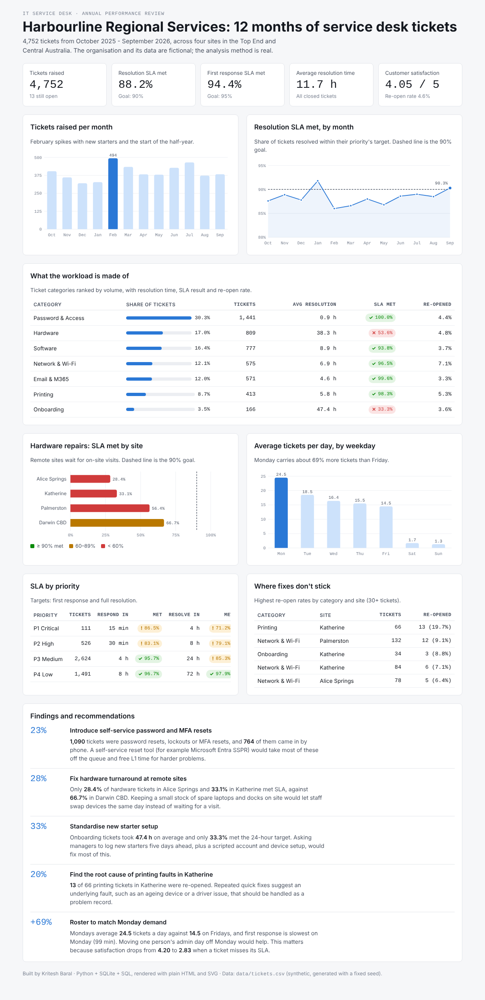

# Service Desk Analytics

An end-to-end analysis of 12 months of IT service desk tickets for **Harbourline Regional Services**, a fictional organisation with four sites across the Top End and Central Australia (Darwin CBD, Palmerston, Katherine, Alice Springs).

The project answers the questions an IT service manager asks every month:

- Are we meeting our SLAs, and where are we missing them?
- What kinds of problems make up the workload?
- Which fixes don't stick?
- When is demand highest, and are we staffed for it?
- What should we change first?

**Live dashboard:** https://kriteshbaral.github.io/service-desk-analytics/

Or open `dashboard/index.html` locally in any browser (no server needed).



## Key findings

| Finding | Evidence | Recommendation |
|---|---|---|
| 23% of all tickets are password, lockout or MFA resets | 1,090 tickets, 764 of them by phone | Self-service password reset (e.g. Microsoft Entra SSPR) |
| Remote sites wait far longer for hardware fixes | Hardware SLA met: Alice Springs 28.4%, Katherine 33.1%, Darwin CBD 66.7% | Hold spare laptops and docks on site for same-day swaps |
| New starter setup misses its target | Onboarding SLA met 33.3%, average 47.4 h | Five-day notice from managers + scripted account and device setup |
| One recurring fault keeps coming back | Printing in Katherine re-opened 19.7% of the time | Raise a problem record and find the root cause |
| Monday demand is ~70% higher than Friday | 24.5 vs 14.5 tickets a day; slowest first response on Monday | Roster extra cover on Mondays |
| Missing SLA hurts satisfaction | CSAT 4.20 when SLA met vs 2.83 when breached | Prioritise the SLA fixes above |

The full write-up is in [`docs/findings.md`](docs/findings.md).

**Follow-up project:** the top recommendation (self-service for password and common issues) is built in [Harbourline IT Help](https://github.com/kriteshbaral/helpdesk-assistant), an offline helpdesk assistant with automatic ticket triage. [Try it live](https://kriteshbaral.github.io/helpdesk-assistant/).

## How it works

```
data/generate_tickets.py  ->  data/tickets.csv          (synthetic ticket log, fixed seed)
sql/schema.sql            ->  SQLite table + view       (calculated fields: SLA met, hours, month)
sql/analysis.sql          ->  11 named SQL queries       (KPIs, trends, SLA, categories, sites ...)
analysis/run_analysis.py  ->  analysis/output/*.csv     (one CSV per query, ready for Excel / Power BI)
                          ->  dashboard/data.js          (same results for the dashboard)
dashboard/index.html      ->  interactive dashboard     (plain HTML, CSS, SVG and JavaScript)
```

## Run it yourself

Requires Python 3.9+ (standard library only).

```bash
python3 data/generate_tickets.py     # creates data/tickets.csv
python3 analysis/run_analysis.py     # runs the SQL and writes the outputs
# then open dashboard/index.html in your browser
```

## Skills demonstrated

- **SQL:** aggregation, `CASE` logic, subqueries, `HAVING`, date functions, views
- **ITIL service management:** incident priorities, response and resolution SLAs, re-opens, problem management, CSAT
- **Data analysis:** turning raw ticket data into KPIs and root-cause findings
- **Data visualisation:** a responsive dashboard with light and dark themes, built without a charting library
- **Business analysis:** recommendations tied to evidence, written for a non-technical manager

## About the data

The dataset is **synthetic**: `generate_tickets.py` creates 4,752 tickets with realistic patterns (Monday peaks, a February spike, slower on-site repairs at remote sites, a recurring printer fault). No real people or organisations are involved. Because the seed is fixed, every run produces the same data, so the numbers in this README always match.

---

Built by **Kritesh Baral** · [LinkedIn](https://linkedin.com/in/kriteshbaral) · [GitHub](https://github.com/kriteshbaral)
